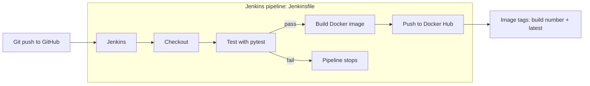
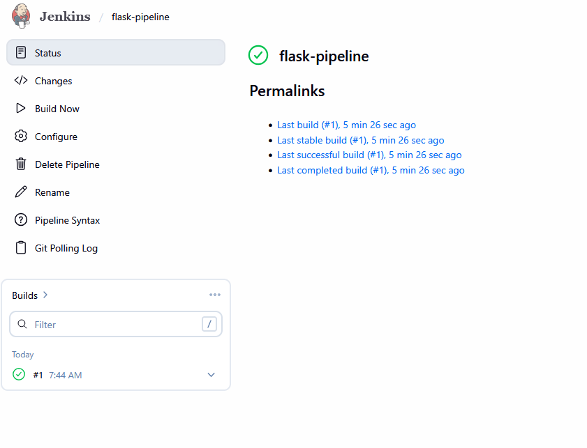
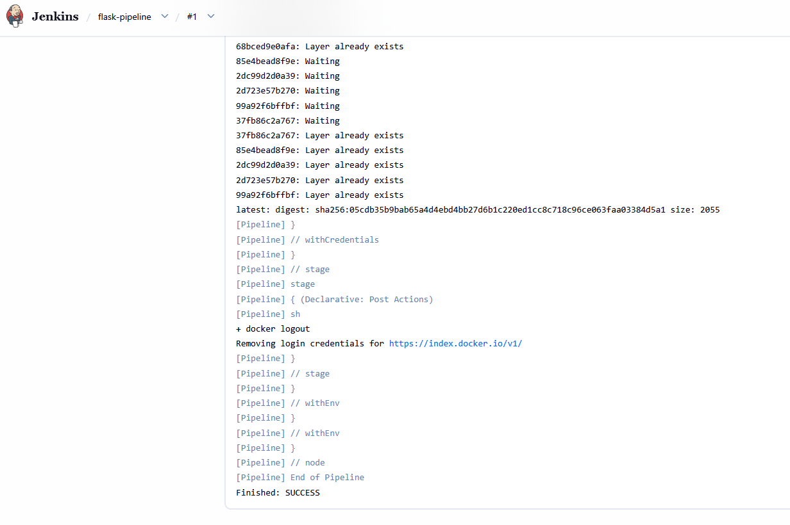
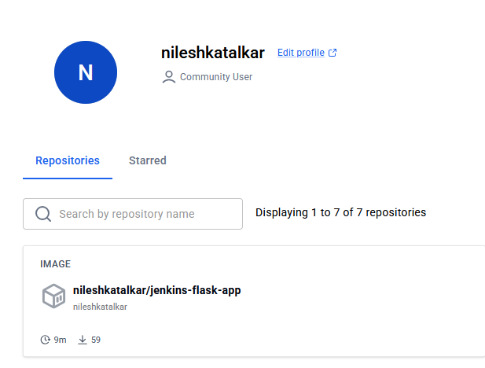
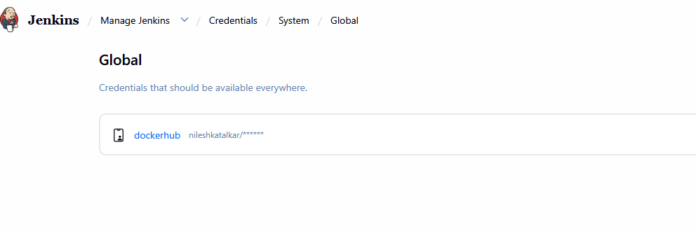

# Jenkins CI/CD Pipeline: Flask App to Docker Hub

A Jenkins pipeline, defined as code in a `Jenkinsfile`, that tests a Flask application, builds a Docker image, and pushes it to Docker Hub. Jenkins itself runs in a Docker container, so the whole setup can be recreated on any machine with Docker.

## Pipeline overview



| Stage | What it does |
|-------|--------------|
| **Checkout** | Pulls the latest code from this GitHub repository |
| **Test** | Creates a Python virtual environment, installs dependencies, runs `pytest` |
| **Build image** | Builds the Docker image and tags it with the build number and `latest` |
| **Push image** | Logs in to Docker Hub using a stored credential and pushes both tags |
| **Post: logout** | Always logs out of Docker Hub, even if the build failed |

Every build gets a unique, traceable tag (`jenkins-flask-app:12`, for example) as well as `latest`.

## Tech stack

- **CI server:** Jenkins (LTS, running in Docker)
- **Pipeline as code:** declarative `Jenkinsfile`
- **Application:** Python, Flask, Gunicorn
- **Testing:** Pytest
- **Containers:** Docker, Docker Compose
- **Registry:** Docker Hub

## Project structure

```
jenkins-pipeline-demo/
├── Jenkinsfile                 # The pipeline definition
├── app.py                      # Flask application
├── test_app.py                 # Unit tests
├── requirements.txt            # Python dependencies
├── Dockerfile                  # Image for the Flask app
├── .dockerignore               # Keeps venv and git files out of the image
├── jenkins/
│   ├── Dockerfile              # Jenkins image with Python and Docker CLI added
│   └── docker-compose.yml      # Runs Jenkins with a persistent volume
├── docs/                       # Screenshots used in this README
└── README.md
```

## Run it yourself

### 1. Start Jenkins

```bash
cd jenkins
docker compose up -d --build
docker compose exec jenkins cat /var/jenkins_home/secrets/initialAdminPassword
```

Open http://localhost:8082, paste the password, install the suggested plugins, and create an admin user.

Jenkins uses the host's Docker through the mounted Docker socket (see `jenkins/docker-compose.yml`). This is fine for a local lab. In production, builds would run on separate, restricted agents.

### 2. Add the Docker Hub credential

1. Create a Docker Hub **access token** with Read & Write permission.
2. In Jenkins, go to **Manage Jenkins > Credentials > System > (global) > Add Credentials**.
3. Set **Kind** to *Username with password*, enter your Docker Hub username and the token.
4. Open **Advanced** and set the **ID** to exactly `dockerhub`. If the ID is left empty, Jenkins generates a random one and the pipeline cannot find the credential.

The token is stored inside Jenkins and never appears in the code or the logs.

### 3. Create the pipeline job

1. **New Item** > name it `flask-pipeline` > **Pipeline**.
2. Under **Pipeline**, set **Definition** to *Pipeline script from SCM*.
3. SCM: *Git*, Repository URL: `https://github.com/nileshkatalkar/jenkins-pipeline-demo.git`, Credentials: *none* (the repository is public).
4. Branch: `*/main`, Script Path: `Jenkinsfile`.
5. Save, then click **Build Now**.

Optional: under **Build Triggers**, enable **Poll SCM** with `H/5 * * * *` so Jenkins checks for new commits every 5 minutes.

### 4. Use the image

```bash
docker pull nileshkatalkar/jenkins-flask-app:latest
docker run -p 5000:5000 nileshkatalkar/jenkins-flask-app:latest
```

Open http://localhost:5000.

## Screenshots

<!-- Save your screenshots in the docs/ folder with these names -->

**Pipeline stage view: all stages green**



**Console output ending with SUCCESS**



**Image published on Docker Hub, with build-number tags**



**Credential stored in Jenkins (ID `dockerhub`, no secrets shown)**



## Problems I hit and how I solved them

| Problem | Cause | Fix |
|---------|-------|-----|
| `Could not find credentials entry with ID 'dockerhub'` | The credential was created without an ID, so Jenkins generated a random one | Created the credential with the explicit ID `dockerhub` and checked the ID column |
| Plugin installation failed with `PKIX path building failed` | The network's firewall re-signs HTTPS traffic, and Java inside the container did not trust that certificate | Added the firewall's CA certificate to the container's trust store (or used a different network) |
| Docker build context was 21 MB | The `venv` folder created during the test stage was copied into the image build | Added a `.dockerignore`; the context dropped to about 25 KB |
| Package downloads timed out while building the Jenkins image | Network blocked plain HTTP to the Debian mirrors | Added `apt` retries and rebuilt on a working connection |

## What I learned

- Writing a declarative Jenkins pipeline with stages, environment variables, and a post-build step
- Keeping secrets out of code with the Jenkins credentials store and `withCredentials`
- Running Jenkins in Docker with a persistent volume, and letting it build images through the host's Docker
- Tagging images with build numbers for traceability
- Reading build logs to diagnose credential, certificate, and network problems

## Possible improvements

- Trigger builds with a GitHub webhook instead of polling
- Add linting and a vulnerability scan (for example Trivy) as extra stages
- Run builds on a separate Jenkins agent instead of the controller
- Deploy the pushed image automatically to a server or Kubernetes cluster
- Compare this pipeline with the GitHub Actions version in the `flask-cicd-pipeline` repo

## Author

**Nilesh Katalkar**
[LinkedIn](https://linkedin.com/in/nilesh-katalkar-984385195/) · [GitHub](https://github.com/nileshkatalkar)
